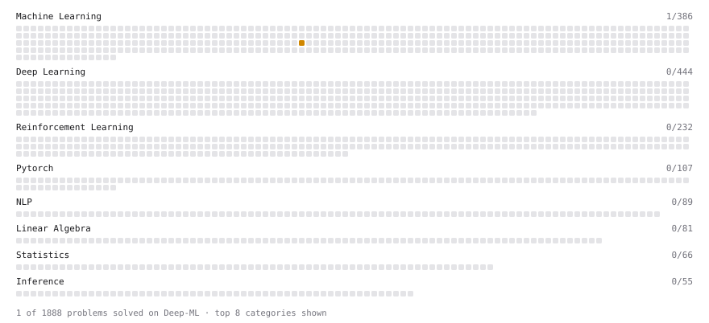

# Deep-ML

My machine learning practice from [Deep-ML](https://www.deep-ml.com). Every solution here was written by hand.

**5** solved · 5 problems · 0 labs · 0 math

[**Browse the interactive portfolio**](https://tudouzz0425.github.io/deep-ml/) to replay this filling in over time.

## Problems

| | Difficulty | Solved | |
| --- | --- | --- | --- |
| [Calculate R-squared for Regression Analysis](https://www.deep-ml.com/problems/69) | easy | 2026-11-05 | [solution](problems/0069-calculate-r-squared-for-regression-analysis) |
| [Dummy Classifier Baseline](https://www.deep-ml.com/problems/847) | medium | 2026-11-02 | [solution](problems/0847-dummy-classifier-baseline) |
| [Dummy Regressor Baseline](https://www.deep-ml.com/problems/848) | medium | 2026-11-02 | [solution](problems/0848-dummy-regressor-baseline) |
| [Mini-Batch Gradient Descent Step for Linear Regression](https://www.deep-ml.com/problems/803) | medium | 2026-11-05 | [solution](problems/0803-mini-batch-gradient-descent-step-for-linear-regression) |
| [Stochastic Gradient Descent Step for Linear Regression](https://www.deep-ml.com/problems/802) | medium | 2026-11-04 | [solution](problems/0802-stochastic-gradient-descent-step-for-linear-regression) |

---

_This file is regenerated by Deep-ML on every push._
